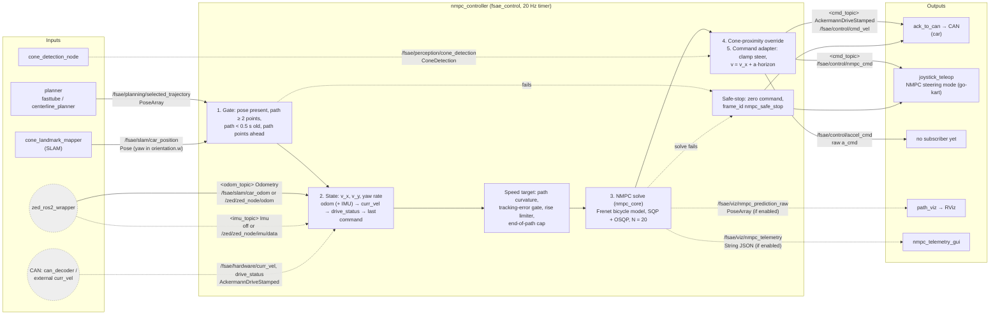

# The NMPC controller: how it fits into ROS2

A practical guide to `nmpc_controller.py`: the topics it needs, what it publishes, how to
launch it, and commands for the RViz visualisation and the hardware-free bench rig that
ship with it.

- **The maths** (state vector, model, cost, SQP solve procedure): `nmpc_core.py`'s module
  docstring. This doc covers only the ROS2 integration.
- **Hardware and sensor gaps** and how each is worked around:
  [`docs/NMPC_INTEGRATION_GAPS.md`](../../../../docs/NMPC_INTEGRATION_GAPS.md).
  **Read it before running this on the car.**
- **Weights and vehicle constants were set and tuned in simulation.** UNVERIFIED on the
  car or kart.

Run every `colcon`/`ros2` command below from the colcon workspace root.

## What's in this folder

| File | What it is |
|---|---|
| `nmpc_core.py` | The solver: Frenet-frame nonlinear bicycle model, Gauss-Newton SQP, OSQP for the inner QP. |
| `nmpc_params.py`, `mpc_params.py` | Every tunable weight/flag (`NMPCParams`, `MPCParams` dataclasses), declared as ROS2 parameters. |
| `control_limits.py` | Steering/acceleration limits and helpers `nmpc_core.py` needs, kept separate so this package does not depend on `cvxpy`/`clarabel`. |
| `nmpc_controller.py` | **The ROS2 node.** Subscribes to the path/pose/sensor topics below, calls `nmpc_core.py` once per tick, publishes the command. This doc is about this file. |
| `mock_pose_path_publisher.py` | Bench stimulus (scripted pose and path), see [`docs/NMPC_VALIDATION_AND_TESTING.md`](../../../../docs/NMPC_VALIDATION_AND_TESTING.md). |
| `bench_scenarios.py` | Path-shape generators (`straight`/`gentle_turn`/`sharp_turn`/`s_curve`, plus a randomised-start offset) the mock publisher dispatches on, see `docs/NMPC_VALIDATION_AND_TESTING.md`. |
| `nmpc_bench.rviz` | RViz config for the bench rig: Fixed Frame `map`, the centerline + predicted-trajectory `MarkerArray` displays pre-added. Loaded by `nmpc_bench.launch.py use_viz:=true`. |
| `nmpc_shadow.rviz` | RViz config for shadow mode (`nmpc_shadow.launch.py`): as `nmpc_gokart.rviz`, with the arrow showing the NMPC's unsent steering. |
| `nmpc_gokart.rviz` | RViz config for the go-kart ground test (`nmpc_gokart.launch.py`): the bench displays plus the SLAM trajectory and a TF display. |
| `nmpc_telemetry_gui.py` | Live matplotlib dashboard (bird's-eye car + predicted path + rolling error/command charts), see "Live telemetry GUI" below. |

## How it fits into the pipeline

### Inputs and outputs flow chart

What goes into `nmpc_controller` and what comes out, at 20 Hz. Solid arrows are used on
every launch; dashed arrows are optional or fallbacks. Topic names in `<angle brackets>`
are node parameters: the car default is shown first, the go-kart launch
(`nmpc_gokart.launch.py`) value second. The full repo wiring is diagram 2 of
[`docs/ARCHITECTURE.md`](../../../../docs/ARCHITECTURE.md).



<details>
<summary>Mermaid source (edit this, then re-render the image, see docs/diagrams/README.md)</summary>



</details>

| Port | Required? | Used for |
|---|---|---|
| `selected_trajectory` | yes | the reference path; spline curvature and heading for the model |
| `car_position` | yes | x, y, yaw of the reference point (the ZED lens on the kart) |
| `<odom_topic>` | no, but v_x falls back to open loop without it | v_x (and v_y, yaw rate when the twist is used) |
| `<imu_topic>` | no | yaw rate, ahead of every other source |
| `curr_vel`, `drive_status` | no | 2nd and 3rd-choice v_x |
| `cone_detection` | no | the proximity brake (sets the speed command to 0) |
| `<cmd_topic>` | always published | steering (deg, +left) + speed (m/s); `frame_id` marks a safe-stop |
| `accel_cmd` | always published | raw acceleration, unconsumed (gap B1) |
| `nmpc_prediction_raw`, `nmpc_telemetry` | only when their `nmpc_publish_*` flag is on | RViz and the dashboard |

Selected by the `controller:=nmpc` launch arg (default `stanley`), so the node is opt-in.

## Topics: what it needs, what it publishes

### Subscribes

| Topic | Type | Required? | Notes |
|---|---|---|---|
| `/fsae/planning/selected_trajectory` | `geometry_msgs/PoseArray` | **Required** | The planner's centreline. Must have ≥2 points and be refreshed at least every `PATH_TIMEOUT` (0.5 s), or the node safe-stops. |
| `/fsae/slam/car_position` | `geometry_msgs/Pose` | **Required** | `x`, `y` in `.position`; **yaw in radians in `.orientation.w`** (repo convention, not a real quaternion, see gap A5). No solve happens until one message arrives. |
| `odom_topic` param, default `/fsae/slam/car_odom` | `nav_msgs/Odometry` | Optional | The default topic has no publisher (gaps A1/A2/A3/A7). Preferred `v_x`/`v_y`/yaw-rate source while under `state_timeout_s` (0.3 s) old. `odom_velocity_source: twist` reads the twist; `pose_diff` differentiates the stamped pose. The kart launch uses `/zed/zed_node/odom` with `pose_diff`. |
| `imu_topic` param, default `''` (off) | `sensor_msgs/Imu` | Optional | When set and fresh, `angular_velocity.z` (× `imu_yaw_rate_sign`) is the yaw rate, ahead of every other source. The kart launch uses `/zed/zed_node/imu/data`. |
| `/fsae/hardware/curr_vel` | `ackermann_msgs/AckermannDriveStamped` | Optional (placeholder) | 2nd-choice `v_x` source; nothing publishes it yet. |
| `/fsae/hardware/drive_status` | `ackermann_msgs/AckermannDriveStamped` | Optional | 3rd-choice `v_x` source, from `can_decoder`'s 1 m/s-resolution CAN byte. |
| `/fsae/perception/cone_detection` | `fsae_interfaces/ConeDetection` | Optional | Proximity emergency-brake input, car-local frame. Empty or absent makes the brake a no-op. |

If none of `odom_topic`/`curr_vel`/`drive_status` is publishing (true on the car's
default topics and on the bench rig), `v_x` falls back to the node's own last commanded
speed. That is open loop, but it does not stop the node running.

### Publishes

| Topic | Type | Notes |
|---|---|---|
| `cmd_topic` param, default `/fsae/control/cmd_vel` | `ackermann_msgs/AckermannDriveStamped` | The command: speed (m/s) + steering (deg). Consumed by `ack_to_can` on the default topic. `header.frame_id` is `nmpc_safe_stop` on a safe-stop command, `nmpc_controller` otherwise. The kart launch publishes on `/fsae/control/nmpc_cmd`, read by `joystick_teleop`'s NMPC steering mode. |
| `/fsae/control/accel_cmd` | `ackermann_msgs/AckermannDriveStamped` | Placeholder (gap B1): the raw signed acceleration in `.drive.acceleration`. Nothing consumes it yet. |
| `/fsae/viz/nmpc_prediction_raw` | `geometry_msgs/PoseArray` | RViz only, gated by `nmpc_publish_prediction_enabled` (default off). `"map"`-frame Cartesian conversion of the predicted horizon. |
| `/fsae/viz/nmpc_telemetry` | `std_msgs/String` (JSON) | `nmpc_telemetry_gui.py` only, gated by `nmpc_publish_telemetry_enabled` (default off). `last_telemetry`'s ~30 fields plus `vx_source`/`car_x`/`car_y`/`car_yaw`, see "Live telemetry GUI" below. |

## Running it

```bash
# from the workspace root
colcon build --packages-select fsae_control
source install/setup.bash
ros2 launch fsae_bringup control.launch.py controller:=nmpc
```

`controller:=stanley` is the default. Every `MPCParams`/`NMPCParams` field is also a
launch argument, generated from the dataclasses, so a weight can be overridden directly:

```bash
ros2 launch fsae_bringup control.launch.py controller:=nmpc nmpc_q_e_y:=12.0
```

The node always follows the live planner path. Driving a precomputed path or speed
profile is not supported.

### On the go-kart (steering only)

```bash
ros2 launch fsae_bringup nmpc_gokart.launch.py
```

The NMPC steers while the driver holds X + R1; the driver keeps the throttle on R2. The kart's
ECU firmware has its brake actuator disabled, so L2 does not slow the kart.
The launch sets the kart's geometry through the node's `plant_*` parameters (`plant_lf`
0.86, `plant_lr` 0.14, kinematic below 8 m/s), which `NMPCController(plant_overrides=...)`
applies over the default vehicle model. The defaults it does not override come from a
simulated vehicle (UNVERIFIED on the kart). See
[`docs/NMPC_GOKART_GROUND_TEST.md`](../../../../docs/NMPC_GOKART_GROUND_TEST.md) for
controls, measurements and the bring-up checklist.

## Visualising the predicted trajectory in RViz

The predicted-trajectory publish is gated by `nmpc_publish_prediction_enabled` (default
off, no per-tick cost when off). The bench test, the kart launch and shadow mode all turn
it on and open RViz with a ready config. To see it with `control.launch.py` instead, turn
it on directly and bring up the viz nodes and RViz separately:

```bash
ros2 launch fsae_bringup control.launch.py controller:=nmpc nmpc_publish_prediction_enabled:=true
# in a second terminal (source install/setup.bash there too):
ros2 launch fsae_bringup viz.launch.py
rviz2
```

In RViz: set **Fixed Frame** to `map`, then **Add → By topic** and add a `MarkerArray`
display for each of:

- `/fsae/viz/centerline`: the planner's chosen path (red cubes)
- `/fsae/viz/nmpc_prediction`: the NMPC's predicted trajectory (orange line)

Together they show the planned path and what the controller intends to do about it,
updating at 20 Hz.

## Bench test (no vehicle)

`nmpc_bench.launch.py` runs the NMPC against a scripted mock pose and path, with RViz
and the dashboard. **No command reaches any vehicle** (the command is remapped to
`/fsae/control/nmpc_bench_cmd`, which nothing consumes), and the mocked car never
responds to the NMPC. It only checks that the NMPC computes the right output for a clean
state. Commands, scenarios, what each run should look like and everything the bench
mocks: [`docs/NMPC_VALIDATION_AND_TESTING.md`](../../../../docs/NMPC_VALIDATION_AND_TESTING.md#2-bench-test-no-vehicle).

```bash
ros2 launch fsae_bringup nmpc_bench.launch.py use_viz:=true
```

## Shadow mode: watch the NMPC while something else drives

`nmpc_shadow.launch.py` runs `nmpc_controller` (kart settings), RViz and the dashboard
next to a launch that is already driving. It reads the real path, pose, odometry and IMU
and publishes its command on `/fsae/control/nmpc_shadow_cmd`, which nothing consumes, so
it never drives. Details, what working looks like and its limits:
[`docs/NMPC_VALIDATION_AND_TESTING.md`](../../../../docs/NMPC_VALIDATION_AND_TESTING.md#3-shadow-mode-on-the-kart-validate-prediction-nmpc-never-drives).

```bash
ros2 launch fsae_bringup nmpc_shadow.launch.py
```

## Telemetry dashboard (live)

`nmpc_telemetry_gui.py` is a matplotlib window: bird's-eye view, rolling `e_y`/`e_psi`/
steering charts and a stat panel including the `v_x` source (green `car_odom`, orange
`curr_vel`/`drive_status`, red `last_cmd (open-loop)`). It needs
`nmpc_publish_telemetry_enabled` on the controller, which `use_gui:=true` sets.

```bash
ros2 launch fsae_bringup nmpc_gokart.launch.py use_gui:=true          # on the kart
ros2 launch fsae_bringup autonomous.launch.py controller:=nmpc use_gui:=true
ros2 run fsae_control nmpc_telemetry_gui                              # against a running controller
```

Without telemetry it shows "NO TELEMETRY" rather than stale numbers.

## Running the tests

```bash
# from the workspace root
colcon build --packages-select fsae_control
source install/setup.bash
colcon test --packages-select fsae_control --pytest-args -v
colcon test-result --verbose
```

- `test_nmpc_core_math.py`: solver self-consistency. Agreement between the scalar and
  vectorised rollout paths, forward-vs-central-difference Jacobians, SQP cost monotonic
  convergence, and the `xy_at()`/`project()` Frenet round trip the RViz visualisation
  depends on.
- `test_nmpc_signs_magnitudes.py`: behavioural contract tests. Correct steering
  sign/magnitude for a lateral or heading offset, correct accel/brake sign for a speed
  error, output limits respected under adversarial input.
- `test_nmpc_plant_overrides.py`: the `plant_*` overrides. Defaults untouched when
  omitted, bad input rejected, steering limit respected, and the kart geometry asking for
  the kinematic steering angle on a steady arc.
- `test_bench_scenarios.py`: geometry checks for `bench_scenarios.py`. Evenly spaced
  turn/S-curve waypoints with bounded curvature, S-curve bends that cancel, and
  `random_start_offset()` within its bound, and the mock pose held after the end of the
  path.

`nmpc_telemetry_gui.py` has no automated test; it is an interactive matplotlib app with a
live ROS2 graph dependency. Verify it by running it (see "Live telemetry GUI" above).

## Before running any of this on the real car

Read [`docs/NMPC_INTEGRATION_GAPS.md`](../../../../docs/NMPC_INTEGRATION_GAPS.md) in
full. In short:

- Several inputs (`v_x`/`v_y`/yaw rate, an acceleration command channel) have no real
  sensor or CAN channel on the car and fall back to a degraded estimate or placeholder.
  None of that stops the node running.
- The weights and vehicle constants were tuned in simulation, and the yaw sign
  convention is unchecked on the car. UNVERIFIED until that document's bring-up ladder
  is followed.
