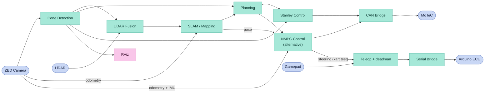
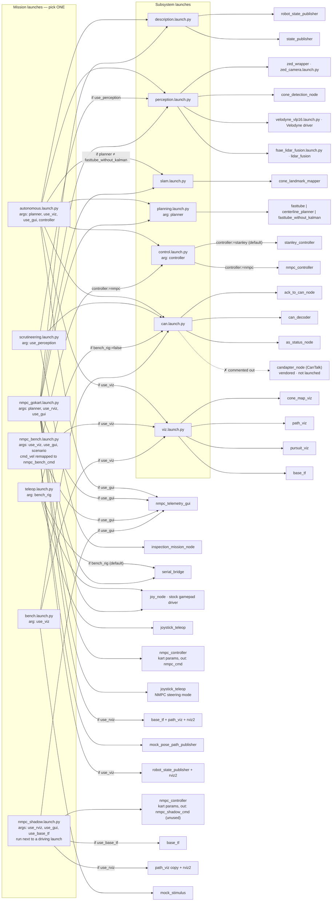

# Architecture & data flow
 
Onboarding diagrams for the `fsae_autonomous` stack. Three views, increasing in detail:
 
1. **High-level pipeline** — the 5-minute "what does it do" view (general terms).
2. **Node ↔ topic graph** — the real ROS 2 wiring (who publishes/subscribes what).
3. **Launch / bring-up tree** — what each `ros2 launch` actually starts.

Per-node charts: only the NMPC has one, its inputs and outputs in
[`MPC_NODE_DOCS.md`](../control/fsae_control/fsae_control/mpc/MPC_NODE_DOCS.md#inputs-and-outputs-flow-chart).
Every other node is described only by diagram 2 and the connection table below it.
 
All diagrams are **Mermaid**, shown as rendered SVGs from `docs/diagrams/` with the Mermaid source in a collapsed block under each (GitHub also renders the source). They are hand-built and
**verified against the source** (every `create_publisher` / `create_subscription` and the
C++ camera node) as of this commit. The **connection table** under diagram 2 is the
authoritative, exhaustive list — rebuild from that if you port these to Lucid.
 
> Verify the live graph on the Jetson with `rqt_graph` / `ros2 node info <node>`; that's
> ground truth. These diagrams are the curated, readable version.
 
---
 
## 1. High-level pipeline (conceptual)
 
Subsystem names only — how data flows from the sensors to the kart. The real node and
topic wiring is diagram 2.
 


<details>
<summary>Mermaid source (edit this, then re-render the image, see docs/diagrams/README.md)</summary>



</details>
 
**Reading it:** the camera node does two jobs — detect cones (YOLOv8 on the Jetson GPU) and
report where the car is (visual-inertial odometry, taken from the ZED wrapper's pose). That's
why Cone Detection has arrows reaching forward to Planning and Stanley: those carry the pose,
not cones. Cones build a landmark map (Kalman-filtered); planning turns the map + pose into a
target path (track boundaries → trajectory); Stanley turns the path + pose into a steering and
speed command; the CAN bridge encodes that as bus frames (Ackermann ↔ CAN). LiDAR Fusion
refines the camera's cone positions against the Velodyne cloud.
 
The direct **Cone Detection → Planning** arrow is the `fasttube_without_kalman` planner, which
skips mapping and plans straight off raw detections.
 
**NMPC Control** is the alternative to Stanley (`controller:=nmpc`). It plans about a second
ahead against a vehicle model instead of reacting to the current error, and needs speed and
yaw rate as well as the pose, which it takes from the ZED's odometry and IMU. On the car it
publishes the same `cmd_vel` Stanley does. On the go-kart ground test it only steers: its
steering goes through the teleop node, which applies the pad deadman and leaves the
throttle with the driver (`nmpc_gokart.launch.py`).

**The dashed edge is the gap.** (LiDAR Fusion → SLAM used to be one: `cone_landmark_mapper`
now maps from `/cone_detection_fused`.) `control → CAN` is real (`cmd_vel → ack_to_can → can_tx`), but `can_tx` has no subscriber
while the CAN-to-bus bridge (`candapter_node`, ported from CanTalk) stays commented out in
`can.launch.py`, so commands stop at the topic and never reach the kart.
 
**Serial Bridge → Arduino ECU** is the go-kart's alternative to the CAN path: open-loop
actuator efforts over serial instead of Ackermann over CAN. Only one of the two bridges runs
at a time. `teleop.launch.py` starts it by default (`bench_rig:=true`), and so does
`nmpc_gokart.launch.py`.
 
---
 
## 2. Node ↔ topic graph (the real wiring)
 
Boxes are **ROS nodes** (ROS node name on top, package/source beneath). Arrows are
**topics** (labelled with the signal name + message type). Solid = a live publisher→subscriber
link. **Dashed red** = a dangling/orphan/external link (see notes). Only **one planner** and
**one cmd_vel source** run at a time.

```mermaid
flowchart LR
    classDef orphan stroke:#c0392b,stroke-dasharray:5 5,color:#c0392b;
    classDef ext fill:#eee,stroke:#888,stroke-dasharray:3 3;
 
    subgraph PERC["perception/"]
        CAM["cone_detection_node<br/>fsae_camera · subscribes to zed_ros2_wrapper"]
        LF["lidar_fusion<br/>fsae_lidar · in perception.launch"]
        VLP["velodyne_transform_node<br/>apt velodyne · in perception.launch"]
    end
    subgraph SLAMG["slam/"]
        MAP["cone_landmark_mapper<br/>fsae_slam · iSAM2"]
    end
    subgraph PLANG["planning/ — ONE at a time"]
        FT["fasttube"]
        CL["centerline_planner"]
        FTNK["fasttube_without_kalman"]
    end
    subgraph CTRLG["control/ — ONE steering source"]
        STAN["stanley_controller<br/>fsae_control · controller"]
        NMPC["nmpc_controller<br/>fsae_control · controller:=nmpc / nmpc_gokart"]
    end
    ZEDW(("zed_ros2_wrapper<br/>ZED 2i driver")):::ext
    subgraph CANG["hardware/ — CAN bridge"]
        A2C["ackermann_to_can<br/>ack_to_can_node"]
        DEC["can_decoder"]
        SYS["autonomous_sys_status<br/>as_status_node"]
        CTK["candapter_node (CanTalk)<br/>vendored · not launched"]
    end
    subgraph SERG["hardware/ — serial bridge (go-kart)"]
        SBR["serial_bridge<br/>fsae_serial_bridge · teleop / nmpc_gokart launches"]
    end
    subgraph MISG["mission / alt cmd_vel sources"]
        INSP["inspection_mission_node<br/>fsae_mission_control"]
        MOCK["mock_stimulus<br/>bench"]
        JOYD["joy_node<br/>stock gamepad driver"]
        JOY["joystick_teleop<br/>teleop"]
    end
    subgraph VIZG["viz/ — optional (RViz)"]
        CMV["cone_publisher<br/>cone_map_viz"]
        PV["publish_path_planning_msgs<br/>path_viz"]
        PPV["publish_pure_pursuit_msgs<br/>pursuit_viz"]
        BTF["static_transform_publisher<br/>base_tf"]
        NGUI["nmpc_telemetry_gui<br/>use_gui:=true"]
    end
    HW(("Kart / MoTeC<br/>physical CAN bus")):::ext
    ARD(("Hub Arduino<br/>go-kart ECU")):::ext
 
    %% ----- core data flow -----
    LF -->|"cone_detection_fused · ConeDetection"| MAP

    %% ----- camera-LiDAR fusion (now in perception.launch, so also in autonomous) -----
    CAM -->|"perception/cone_detection (seeds)"| LF
    VLP -->|"/velodyne_points · PointCloud2"| LF
    LF -. "lidar_fusion/seed_markers + cone_points + ground_points — RViz only" .-> LF
    CAM -->|"perception/cone_detection"| FTNK
    MAP -->|"slam/car_position · Pose (corrected)"| FT
    MAP -->|"slam/car_position"| CL
    CAM -->|"slam/car_position (raw, no SLAM)"| FTNK
    MAP -->|"slam/car_position"| STAN
    MAP -->|"slam/car_position"| NMPC
    ZEDW -->|"/zed/zed_node/odom · Odometry<br/>(odom_topic)"| NMPC
    ZEDW -->|"/zed/zed_node/imu/data · Imu<br/>(imu_topic)"| NMPC
    ZEDW -->|"/zed/zed_node/odom"| MAP
    CAM -->|"perception/cone_detection<br/>(proximity brake)"| NMPC
 
    MAP -->|"slam/left_track · Track"| FT
    MAP -->|"slam/right_track · Track"| FT
    MAP -->|"slam/left_track"| CL
    MAP -->|"slam/right_track"| CL
 
    FT -->|"planning/selected_trajectory<br/>PoseArray"| STAN
    CL -->|"planning/selected_trajectory"| STAN
    FTNK -->|"planning/selected_trajectory"| STAN
    FT -->|"planning/selected_trajectory"| NMPC
    CL -->|"planning/selected_trajectory"| NMPC
 
    STAN -->|"control/cmd_vel<br/>AckermannDriveStamped"| A2C
    NMPC -->|"control/cmd_vel (car, cmd_topic default)"| A2C
    NMPC -->|"control/nmpc_cmd (go-kart)<br/>AckermannDriveStamped"| JOY
    INSP -->|"control/cmd_vel"| A2C
    MOCK -->|"control/cmd_vel"| A2C
    JOYD -->|"joy<br/>sensor_msgs/Joy"| JOY
    JOY -->|"control/cmd_vel"| A2C
 
    %% ----- go-kart serial actuation path: joystick_teleop is the only live publisher -----
    STAN -. "control/actuator_cmd (actuator_cmd_enabled: false)" .-> SBR
    JOY -->|"control/actuator_cmd<br/>ActuatorCmd (deadman, NMPC steering mode)"| SBR
    SBR -->|"S.. T.. B.. ASCII (TX-only)"| ARD
 
    A2C -->|"hardware/can_tx · CANStamped"| CTK
    CTK <-->|"raw CAN frames"| HW
    CTK -->|"hardware/can_rx · CANStamped"| DEC
 
    %% ----- viz subscriptions -----
    CAM -->|"cone_detection"| CMV
    MAP -->|"left_track / right_track"| CMV
    MAP -->|"car_position"| CMV
    FT -->|"selected_trajectory"| PV
    STAN -->|"control/drive_vis · AckermannDrive"| PPV
    NMPC -->|"viz/nmpc_prediction_raw · PoseArray"| PV
    JOY -->|"control/cmd_vel (steering arrow)"| PV
    NMPC -->|"viz/nmpc_telemetry · String JSON"| NGUI
    MAP -->|"car_position"| PPV
 
    %% ----- external / orphan / dangling -----
    HW -. "hardware/curr_vel (external)" .-> INSP
    HW -. "hardware/curr_vel (v_x fallback)" .-> NMPC
    DEC -->|"hardware/drive_status (v_x fallback)"| NMPC
    HW -. "hardware/curr_vel" .-> SYS
    HW -. "mission/mission_status (external)" .-> SYS
    HW -. "hardware/hardware_state (external)" .-> SYS
 
    CAM -. "perception/image — RViz/monitor only" .-> CAM
    MAP -. "slam/times_modified — NO subscriber" .-> MAP
    STAN -. "control/track_point — dead handle, never published" .-> STAN
    DEC -. "battery_state / glv_state — no in-repo subscriber" .-> DEC
    NMPC -. "control/accel_cmd — NO subscriber" .-> NMPC
    SYS -. "mission/as_status — no in-repo subscriber" .-> SYS
    PV -. "inbound_trajectories / trajectories / best_trajectory_index — NO publisher" .-> PV
    PPV -. "planning/track_point — NO publisher (namespace mismatch vs control/track_point)" .-> PPV
 
    class CAM,MAP,STAN,DEC,SYS,PV,PPV,NMPC orphan;
    class CTK ext;
```
 


<details>
<summary>Mermaid source (edit this, then re-render the image, see docs/diagrams/README.md)</summary>



</details>
 
> Mermaid renders the self-loops above as the cleanest way to flag a one-ended (orphan)
> topic. They are **not** real loopbacks — read each as "this node publishes/subscribes a
> topic with no counterpart." Full detail in the table.
 
### Authoritative connection table (every topic, verified from source)
 
| Topic | Type | Carries / does | Publisher(s) | Subscriber(s) | Status |
|---|---|---|---|---|---|
| `/fsae/perception/cone_detection` | `fsae_interfaces/ConeDetection` | `header` (camera capture stamp, `frame_id="camera_link"`) + `car_pose` (ZED pose) + `blue[]`/`yellow[]`/`small_orange[]`/`big_orange[]` cone positions (`Point[]`, in the car's **local** frame). | `cone_detection_node` (camera) | `fasttube_without_kalman`, `cone_map_viz`, `lidar_fusion`, `nmpc_controller` (cone-proximity brake) | OK. **Car pose is embedded as `car_pose` inside this msg** (SLAM no longer uses it: `cone_landmark_mapper` takes pose from `/zed/zed_node/odom`). **`header.stamp` is what `lidar_fusion` time-matches against its buffered `/velodyne_points` clouds** (`max_time_diff`, default 0.10s). **Gated:** only published when both blue *and* yellow cones are in view (`cone_detection.cpp:442`), so one-sided sections starve its consumers that frame. |
| `/fsae/perception/image` | `sensor_msgs/Image` | Annotated camera frame (detection boxes drawn) for live monitoring. | `cone_detection_node` | — | Orphan in-repo; RViz/monitoring only. |
| `/velodyne_points` | `sensor_msgs/PointCloud2` | Raw VLP-16 cloud (`x,y,z,intensity,ring`), frame `velodyne`. | `velodyne_transform_node` (apt `velodyne`, launched by `perception.launch.py`) | `lidar_fusion` | Driver + fusion now come up inside `perception.launch.py` (so also in `autonomous.launch.py` transitively). Default-QoS reliable both ends (compatible). |
| `/lidar_fusion/seed_markers` | `visualization_msgs/MarkerArray` | Camera cone seeds projected into the `velodyne` frame + the crop-sphere boundary + the fitted ground-plane disc + the refined-centroid cylinder per seed, for RViz. | `lidar_fusion` | RViz | Debug viz only. |
| `/lidar_fusion/cone_points` | `sensor_msgs/PointCloud2` | In-sphere points that survived ground removal (ABOVE_GROUND — the input to clustering), for RViz. | `lidar_fusion` | RViz | Debug viz only. Component A refinement complete (crop, ground removal, cluster verification, axis-projection centroid); Component B fused publishing still to come. |
| `/lidar_fusion/ground_points` | `sensor_msgs/PointCloud2` | In-sphere points discarded as ground (AT_GROUND) by the per-point z-test, for RViz. | `lidar_fusion` | RViz | Debug viz only. |
| `/cone_detection_fused` | `fsae_interfaces/ConeDetection` | Fused cones: LiDAR-refined positions (camera body frame) + camera colours + `car_pose` copied from the source detection. One msg per time-matched LiDAR cloud (~10 Hz). | `lidar_fusion` | `cone_landmark_mapper` | Drop-in replacement for the raw camera topic; unconfirmed detections are absent by policy. |
| `/fsae/slam/car_position` | `geometry_msgs/Pose` | Car pose — **SLAM-corrected** when SLAM runs, otherwise raw ZED pose — x,y in `position`, **yaw (rad) repurposed into `orientation.w`** (not a real quaternion). | `cone_landmark_mapper` when SLAM runs; else `cone_detection_node` (`publish_car_position`, set by `autonomous.launch.py`) | `fasttube`, `centerline_planner`, `fasttube_without_kalman`, `stanley_controller`, `nmpc_controller`, `cone_map_viz`, `pursuit_viz`, `path_viz` (steering arrow) | OK. Exactly one publisher at a time. |
| `/fsae/slam/left_track` | `fsae_interfaces/Track` | **Blue (left)** boundary cones from the iSAM2 map (`Point[] cones`), same frame as `slam/car_position`. (`invert_cones:false` default.) | `cone_landmark_mapper` | `fasttube`, `centerline_planner`, `cone_map_viz` | OK. Published at every keyframe and every detection. |
| `/fsae/slam/right_track` | `fsae_interfaces/Track` | **Yellow (right)** boundary cones from the iSAM2 map (`Point[] cones`). | `cone_landmark_mapper` | `fasttube`, `centerline_planner`, `cone_map_viz` | OK. |
| `/fsae/planning/selected_trajectory` | `geometry_msgs/PoseArray` | The single path to follow — centerline waypoints (`Pose[]`; positions only, orientation left zeroed). | `fasttube` **or** `centerline_planner` **or** `fasttube_without_kalman` | `stanley_controller`, `nmpc_controller`, `path_viz` | OK. Exactly one publisher live at a time. |
| `/fsae/planning/inbound_trajectories` | `fsae_interfaces/AllTrajectories` | (Old multi-candidate interface) list of in-track candidate paths; its last entry was used as the centerline reference. | — | `path_viz` | **Orphan sub** — no publisher in repo. |
| `/fsae/planning/trajectories` | `fsae_interfaces/AllTrajectories` | (Old multi-candidate interface) all candidate paths from the scrapped scoring planner. | — | `path_viz` | **Orphan sub** — no publisher. |
| `/fsae/planning/best_trajectory_index` | `std_msgs/Int16` | (Old multi-candidate interface) index of the chosen path within `trajectories`. | — | `path_viz` | **Orphan sub** — no publisher. |
| `/fsae/planning/track_point` | `geometry_msgs/Pose` | Intended pure-pursuit look-ahead/target point (the pursuit-viz "next destination" sphere). | — | `pursuit_viz` | **Orphan sub.** Stanley publishes `control/track_point` (different namespace) and even that handle is dead. |
| `/fsae/control/cmd_vel` | `ackermann_msgs/AckermannDriveStamped` | The drive command — `speed` + `steering_angle` (+ accel/jerk fields); the autonomous command source. | `stanley_controller` **or** `nmpc_controller` (`controller:=nmpc`), `inspection_mission_node`, `mock_stimulus`, `joystick_teleop` | `ack_to_can_node`, `path_viz` (steering arrow) | OK. **No mux** — only one publisher should run per mission (enforced by launch choice). |
| `/fsae/control/actuator_cmd` | `fsae_interfaces/ActuatorCmd` | Raw actuator efforts for the **bench-rig Arduino** — `steering_angle` (deg) + `throttle_percent` (0-100) + `brake_percent` (0-100). The serial-path counterpart to `cmd_vel`. | `stanley_controller` (**TEMP** — steering from the Stanley law + a fixed open-loop throttle param; brake always 0), `joystick_teleop` (manual; triggers map straight to throttle/brake %) | `serial_bridge` | **Live on the go-kart** through `joystick_teleop` (`actuator_cmd_enabled: true`), launched by `teleop.launch.py` (`bench_rig:=true`, default) and `nmpc_gokart.launch.py`. In NMPC steering mode (X + R1) the steering comes from `nmpc_controller` via `control/nmpc_cmd`. Stanley's copy stays off (`actuator_cmd_enabled: false`; it hard-codes `armed=false`). |
| `/fsae/control/nmpc_cmd` | `ackermann_msgs/AckermannDriveStamped` | NMPC steering (deg, +ve left) and speed; `frame_id` `nmpc_safe_stop` on a safe-stop. | `nmpc_controller` (only in `nmpc_gokart.launch.py`, via its `cmd_topic` param) | `joystick_teleop` (NMPC steering mode, `auto_steer_topic`) | Kart ground test only. Steering is used while X + R1 are held; speed is ignored, the triggers drive. |
| `/fsae/control/accel_cmd` | `ackermann_msgs/AckermannDriveStamped` | The NMPC's raw signed acceleration (m/s²) in `.drive.acceleration`. | `nmpc_controller` | — | Orphan: nothing consumes it yet (gap B1). |
| `/zed/zed_node/odom` | `nav_msgs/Odometry` | ZED visual-inertial odometry of `zed_camera_link` in `odom`, header-stamped. | `zed_ros2_wrapper` | `cone_landmark_mapper`, `nmpc_controller` (`odom_topic`, go-kart launch: differentiated for v_x) | External driver topic. |
| `/zed/zed_node/imu/data` | `sensor_msgs/Imu` | ZED 2i IMU; `angular_velocity.z` is the yaw rate. | `zed_ros2_wrapper` | `nmpc_controller` (`imu_topic`, go-kart launch only) | External driver topic. |
| `/fsae/viz/nmpc_prediction_raw` | `geometry_msgs/PoseArray` | The NMPC's predicted path, `map` frame. Only with `nmpc_publish_prediction_enabled`. | `nmpc_controller` | `path_viz` | OK. |
| `/fsae/viz/nmpc_prediction` | `visualization_msgs/MarkerArray` | Line marker of the predicted path. | `path_viz` | RViz | OK. |
| `/fsae/viz/steering_arrow` | `visualization_msgs/MarkerArray` | Arrow at the car showing the commanded steering, from `control/cmd_vel`. | `path_viz` | RViz | OK. |
| `/fsae/viz/nmpc_telemetry` | `std_msgs/String` | JSON of the NMPC's per-tick telemetry. Only with `nmpc_publish_telemetry_enabled`. | `nmpc_controller` | `nmpc_telemetry_gui` | OK. |
| `/fsae/control/drive` | `ackermann_msgs/AckermannDrive` | Unstamped copy of the drive command, intended for hardware/monitor. | `stanley_controller` | — | Orphan in-repo (intended for hardware/monitor). |
| `/fsae/control/drive_vis` | `ackermann_msgs/AckermannDrive` | Copy of the drive command for the pursuit viz (renders the steering). | `stanley_controller` | `pursuit_viz` | OK. |
| `/fsae/control/track_point` | `geometry_msgs/Pose` | Intended pursuit target point (same idea as the planning one) — never actually built or published. | `stanley_controller` (handle created, **never published** — dead code) | — | **Dead.** Also namespace-mismatched vs the viz sub above. |
| `/fsae/hardware/can_tx` | `fsae_interfaces/CANStamped` | One **outbound** CAN frame — `id` (uint16) + up to 8 data bytes; the Ackermann command encoded for the bus (id `0x300`). | `ack_to_can_node` | **none** in-launch (`candapter_node` vendored, commented) | **Outbound dead end** until enabled: `ack_to_can` publishes it, but the CAN-to-bus bridge (`candapter_node`, ported from CanTalk) is commented out in `can.launch.py`, so commands don't reach the kart until it's uncommented on the Jetson. |
| `/fsae/hardware/can_rx` | `fsae_interfaces/CANStamped` | One **inbound** CAN frame read off the bus (same `id` + 8-byte payload). | **none** in-launch (CanTalk vendored, launch-commented) | `can_decoder` | **Inbound dead end** in-repo: no publisher until `candapter_node` (CanTalk — now vendored but commented out in `can.launch.py`) runs on the Jetson. `can_decoder` itself now starts (type fixed). |
| `/fsae/hardware/battery_state` | `sensor_msgs/BatteryState` | Main battery pack status (voltage / current / temperature / cell count) decoded from CAN. | `can_decoder` | — | Orphan in-repo (monitoring). |
| `/fsae/hardware/drive_status` | `ackermann_msgs/AckermannDriveStamped` | Decoded vehicle drive state (speed + steering) from CAN. | `can_decoder` | `nmpc_controller` (3rd-choice v_x source) | Type **fixed** from the non-existent `AckermannStamped` → `AckermannDriveStamped`, so the node now starts. |
| `/fsae/hardware/glv_state` | `sensor_msgs/BatteryState` | Low-voltage (GLV) system status decoded from CAN (id `0x602`). | `can_decoder` | — | Orphan in-repo. |
| `/fsae/hardware/curr_vel` | `ackermann_msgs/AckermannDriveStamped` | Current vehicle velocity/steering feedback from the car (used for the AS "car stopped" check and inspection). | **external** (CanTalk/MoTeC) | `inspection_mission_node`, `autonomous_sys_status`, `nmpc_controller` (2nd-choice v_x source) | No in-repo publisher. |
| `/fsae/hardware/hardware_state` | `fsae_interfaces/HardwareStatesStamped` | MoTeC safety/system flags: `ebs_active`, `ts_active`, `in_gear`, `master_switch_on`, `asb_ready`, `brakes_engaged`. | **external** | `autonomous_sys_status` | No in-repo publisher. |
| `/fsae/mission/mission_status` | `fsae_interfaces/MissionStatesStamped` | Mission state: `mission_selected` + `mission_finished`. | **external** | `autonomous_sys_status` | No in-repo publisher. |
| `/fsae/mission/as_status` | `std_msgs/UInt8` | Autonomous-System state enum: `0` finished, `1` emergency, `2` ready, `3` driving, `4` off. | `autonomous_sys_status` | — | Orphan in-repo (consumed externally). |
| `/fsae/viz/cones` | `visualization_msgs/MarkerArray` | RViz markers for the SLAM map cones (left + right tracks). | `cone_map_viz` | RViz | OK. |
| `/fsae/viz/car` | `visualization_msgs/MarkerArray` | RViz marker for the ego car pose. | `cone_map_viz` | RViz | OK. |
| `/fsae/viz/detections` | `visualization_msgs/MarkerArray` | RViz markers for the per-frame raw detections (note the known cosmetic blue↔yellow colour swap). | `cone_map_viz` | RViz | OK. |
| `/fsae/viz/trajectories` | `visualization_msgs/MarkerArray` | RViz lines for candidate trajectories (chosen=green, others=white) — fed by the dead `AllTrajectories` path. | `path_viz` | RViz | OK. |
| `/fsae/viz/centerline` | `visualization_msgs/MarkerArray` | RViz cubes marking the followed-path waypoints (from `selected_trajectory`). | `path_viz` | RViz | OK. |
| `/fsae/viz/control` | `visualization_msgs/MarkerArray` | RViz markers for the pure-pursuit visualisation (steering, from `drive_vis`). | `pursuit_viz` | RViz | OK. |
 
> **Not shown above:** `fsae_camera` also builds two standalone subscriber executables
> (`cone_subscriber`, `localisation_subscriber`) for smoke-testing — neither is launched
> nor part of the pipeline.
>
> **Dead files, not built:** `velocity/velocity.cpp` and `localisation/localisation.cpp` still
> exist in `fsae_camera` but are **not in the CMake build glob** (`CMakeLists.txt` compiles only
> `cone_detection.cpp`, `yolo.cpp`, `zed_launch.cpp` into `cone_detection_node`). Both still call
> the old `sl::` ZED SDK API from before the wrapper migration. `velocity.cpp` is why
> `/fsae/slam/car_velocity` used to appear in this table — that publisher was **removed** (see the
> note at `zed_launch.hpp`), so the topic no longer exists. Don't re-add it from reading these files.
 
### TF (`/tf`) — separate from topics, currently conflicting
 
Not on the topic graph above because TF is its own tree. Four broadcasters (three on `/tf`,
plus `robot_state_publisher` on `/tf_static`), with an ownership conflict on the `/tf` edges
(see `MIGRATION.md` §9 and `docs/MIGRATION_BUGS.md`):
 
| Broadcaster | Node | Edge it publishes | Note |
|---|---|---|---|
| `cone_map_viz` | `cone_publisher` | `map → base_link` (ego, real pose-driven transform) | live **only with `use_viz:=true`** — `cone_map_viz` is a viz node |
| `base_tf` | `static_transform_publisher` | `map → odom` (placeholder identity) | live placeholder **only with `use_viz:=true`** — a *dynamic* broadcaster on a 1 s timer; named "static" but **not** a latched static TF |
| `state_publisher` | `state_publisher` (description) | `odom → base_link` (placeholder identity) | **FIXED** — identity quaternion + `sendTransform` added; now broadcasts `odom→base_link` at 30 Hz (car pinned at the odom origin) until real odometry exists (see `MIGRATION_BUGS.md`) |
| `robot_state_publisher` | (description) | URDF joint frames + `base_link → sensors` on `/tf_static` | **now actually launches** — was aborting on jazzy (`robot_description` not wrapped in `ParameterValue`; fixed). Default URDF is the **trolley**, so it publishes `base_link → {camera_link, velodyne, zed_camera_optical_frame}` |
 
`base_link` now has **two potential parents**: `odom` (via `state_publisher`, now live) and
`map` (via `cone_map_viz`, only with `use_viz:=true`). With viz on, that's a real conflict —
the deliberate TF-ownership pass (one owner per edge) is still owed.

**On the default headless car (`use_viz:=false`) there is still no `map` frame** — both
`map`-frame broadcasters (`cone_map_viz`, `base_tf`) live in `viz.launch.py`. But unlike
before, `odom → base_link` (`state_publisher`, now fixed) **and** the static `base_link → sensor`
frames (`robot_state_publisher`, now actually launching) publish headless, so a partial tree
rooted at `odom` exists without viz; only the `map` frame still requires visualisation.
 
---
 
## 3. Launch / bring-up tree (what `ros2 launch` starts)
 
Two layers: thin **mission launches** compose reusable **subsystem launches**, which start
the nodes. Each mission picks exactly one `cmd_vel` source (there's no command mux).
 


<details>
<summary>Mermaid source (edit this, then re-render the image, see docs/diagrams/README.md)</summary>



</details>
 
**Key facts:**
- `autonomous.launch.py` auto-**skips SLAM** when `planner:=fasttube_without_kalman` (that
  planner reads raw `cone_detection` instead of the SLAM tracks).
- Default planner is `fasttube`; `use_viz` defaults to `false` (headless car).
- `description.launch.py` now loads the **go-kart** URDF (`gocartv2.urdf.xml`) by default
  (`urdf:=trolly.urdf.xml` for the trolley). Both `robot_state_publisher` (static sensor frames) and `state_publisher`
  (`odom→base_link`) now actually run — previously RSP aborted and `state_publisher` crashed.
- **Camera-LiDAR fusion is now in `perception.launch.py`** — it includes the Velodyne driver
  (`velodyne_vlp16.launch.py`) + `lidar_fusion` (`fsae_lidar_fusion.launch.py`) alongside the
  camera, so it also runs transitively in `autonomous.launch.py` / `scrutineering.launch.py`
  (via `use_perception`). The two `fsae_lidar/launch/*.launch.py` files still work standalone if
  you want to run driver or fusion on their own. Needs the `camera_link → velodyne` TF from
  `description.launch.py`, so start `description` first (fusion self-heals once TF is up, but
  warns until then).
- `can.launch.py` has `candapter_node` (the CanTalk bridge, now vendored) **commented out** —
  so `can_tx` and `can_rx` have no hardware link and the CAN path is not functional end-to-end (commands
  stop at `can_tx`).
- **`fsae_serial_bridge` (go-kart Arduino path)** is launched by `teleop.launch.py`
  (`bench_rig:=true`, the default) and by `nmpc_gokart.launch.py`. `joystick_teleop` feeds it
  (`actuator_cmd_enabled: true`); Stanley's feed stays off. See item 7 below for the design.
- **`controller:=stanley|nmpc`** on `control.launch.py` (and so on `autonomous.launch.py`)
  picks the steering source. Default `stanley`. With `nmpc`, every `MPCParams`/`NMPCParams`
  field is also a launch argument.
- **`nmpc_gokart.launch.py` does not include `control.launch.py` or `can.launch.py`**: it
  starts `nmpc_controller` itself with the kart's parameters, and the kart has no CAN path.
- **`nmpc_bench.launch.py`** runs the NMPC against `mock_pose_path_publisher` (no car, no
  sensors), optionally with RViz and the telemetry GUI. Its `cmd_vel` is remapped to
  `nmpc_bench_cmd`, so no command reaches any vehicle.
- **`nmpc_shadow.launch.py`** runs only the NMPC (publishing on the unused
  `nmpc_shadow_cmd`), RViz and the GUI next to a launch that is already driving, to watch
  the NMPC's prediction against the real sensors. See
  [`NMPC_VALIDATION_AND_TESTING.md`](NMPC_VALIDATION_AND_TESTING.md).
 
---
 
### Go-kart NMPC ground test (`nmpc_gokart.launch.py`)

Steering-only NMPC on the kart: description + perception + slam + planning, then
`nmpc_controller` → `/fsae/control/nmpc_cmd` → `joystick_teleop` (NMPC steering mode while
X + R1 are held) → `/fsae/control/actuator_cmd` → `serial_bridge` → Arduino ECU, plus RViz.
No `control.launch.py`, no `can.launch.py`, no `cone_map_viz`. See
[`NMPC_GOKART_GROUND_TEST.md`](NMPC_GOKART_GROUND_TEST.md).

## Quirks worth knowing (the stuff the diagrams encode)
 
1. **The camera node publishes the raw car pose**, embedded in `cone_detection` and
   standalone on `slam/car_position` (for planning/control/viz). When SLAM runs, the
   standalone copy is switched off (`publish_car_position:=false`) and
   `cone_landmark_mapper` publishes the drift-corrected pose on that topic instead. Since the zed_ros2_wrapper conversion both copies come from
   the **same `image_callback`, once per frame** (the old dedicated ~10 Hz pose thread is
   gone): the standalone pose publishes **unconditionally** every frame, while the embedded
   copy only goes out when the blue-AND-yellow gate passes. Two consequences: (a) planners
   are triggered at frame rate even when zero cones are visible — any pose-driven consumer
   must tolerate empty boundary data (see the fasttube startup-crash fix in
   `MIGRATION_BUGS.md`); (b) the `Pose` still carries **no timestamp/header**, so consumers
   can't align pose snapshots across topics.
2. **SLAM is iSAM2 landmark SLAM** (`cone_landmark_mapper`): a persistent cone map plus a
   drift-corrected pose. No explicit loop closure or relocalization yet, and no `map → odom`
   TF.
3. **`fasttube_without_kalman` bypasses SLAM** entirely (raw detections → trajectory).
4. **No command mux** on `cmd_vel` — four possible publishers; safety relies on launching
   only one. There is no mux or e-stop gate.
5. **CAN hardware bridge not running** — `candapter_node` (ported from CanTalk) is vendored
   but **commented out** in `can.launch.py`, so until it's enabled on the Jetson the hardware
   boundary is severed **both ways**: outbound `can_tx` has no subscriber (commands never reach
   the kart) and inbound `can_rx` has no publisher. (`curr_vel`/`hardware_state`/`mission_status`
   are separate MoTeC-decode paths, still absent regardless.)
6. **Known latent bugs** surfaced here: `can_decoder` combines 16-bit CAN values with `+`
   instead of bit-packing (its non-existent-`AckermannStamped` import bug is now **fixed**).
   `state_publisher` (float→Quaternion crash + missing `sendTransform`) and the
   `fasttube_planner` single-colour DEBUG override are now **fixed / removed**. See
   `docs/MIGRATION_BUGS.md`.
7. **Go-kart serial actuation path.** Built on `feat/arduino-ecu` as an alternative to the
   CAN path for driving the go-kart with an Arduino instead of the MoTeC. `joystick_teleop`
   publishes `control/actuator_cmd` (`ActuatorCmd`: steering + throttle% + brake% + armed),
   which `serial_bridge` (`fsae_serial_bridge`) writes to the Arduino as framed ASCII. In the
   NMPC ground test the steering in that message comes from `nmpc_controller`. Stanley's own
   `actuator_cmd` stays off.
   **Efforts, not speed** — the Arduino has no speed sensor, so ROS owns all vehicle-level
   loops and the Arduino executes efforts (open-loop for now). The throttle is a fixed param in
   Stanley **temporarily**; it moves to a longitudinal controller node once wheel encoders
   enable closed-loop speed. Only one bridge (CAN **or** serial) runs at a time.
```
 